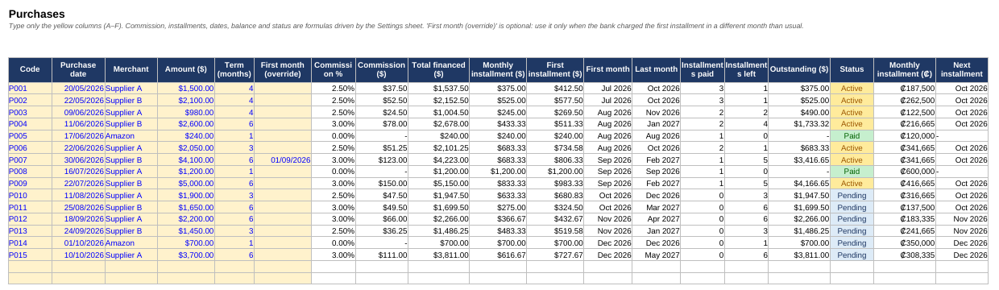
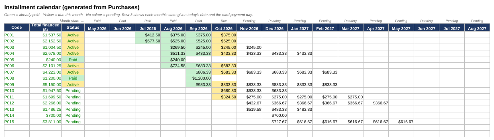

# Card Installment Tracker

[](https://github.com/ManfredM10/card-installment-tracker/actions/workflows/tests.yml)


Track credit-card purchases that are financed in installments (3, 6, 9… months) and
always know **what is due this month, what is already paid and how much is still
outstanding** — without marking anything by hand.

*[Versión en español más abajo](#versión-en-español).*



## The problem

Small businesses that import stock often pay suppliers with a credit card and spread
each purchase over several months to keep the monthly statement manageable. The card
issuer charges a commission that depends on the term and bills it with the first
installment. Keeping track of this in a hand-filled spreadsheet means retyping the same
arithmetic for every purchase, guessing which installments have already been charged,
and ending up with typos (dates in the wrong year, wrong currency symbols) that silently
break the totals.

## What this does

You type five fields per purchase — code, date, merchant, amount and term — and the
tool derives everything else from a small set of configurable business rules:

| Rule | Where it lives |
|---|---|
| Commission per term (e.g. 2.5 % at 3–4 months, 3 % at 6–9) | `config.toml` → `[commissions]` |
| Months between the purchase and the first installment | `config.toml` → `first_installment_offset` |
| Card payment day (an installment counts as paid once that day has passed) | `config.toml` → `payment_day` |
| Optional second currency for a converted view | `config.toml` → `[currency]` |

Two outputs:

1. **An Excel workbook with live formulas** (`build`). Every derived cell is a formula
   referencing a `Settings` sheet, so the file keeps working after you add rows by hand
   or change a commission rate — and it imports cleanly into Google Sheets.
   - `Purchases`: inputs in yellow, everything else calculated; dropdowns and validation
     stop bad terms, dates and currency symbols at the source.
   - `Calendar`: one column per month, each installment coloured **paid / due this
     month / pending** based on today's date.
   - `Summary`: outstanding balance, this and next month's total, breakdown by merchant.
   - `Settings`: the rules above, editable in place.
2. **A plain-text report** (`report`) for a quick look from the terminal, with a
   `--today` flag to see the state at any date.



## Install

Requires Python 3.11+.

```bash
git clone https://github.com/ManfredM10/card-installment-tracker.git
cd card-installment-tracker
pip install -e .
```

## Use

```bash
# 1. copy and edit the rules for your card
cp examples/config.toml config.toml

# 2. keep your purchases in a CSV (see examples/purchases.csv)
#    code,date,merchant,amount,term_months,first_month_override

# 3. build the workbook
installment-tracker build purchases.csv --config config.toml -o tracker.xlsx

# or just look at the numbers
installment-tracker report purchases.csv --config config.toml --today 2026-10-14
```

```
Code      Merchant           Amount  Term     First  Paid    Outstanding  Status
P001      Supplier A   $   1,500.00     4  Jul 2026     3 $       375.00  Active
P004      Supplier B   $   2,600.00     6  Aug 2026     2 $     1,733.32  Active
P005      Amazon       $     240.00     1  Aug 2026     1 $         0.00  Paid
P010      Supplier A   $   1,900.00     3  Oct 2026     0 $     1,947.50  Pending
...
Total outstanding as of 2026-10-14: $23,300.20
```

`first_month_override` is optional: fill it only when the bank charged the first
installment in a different month than the configured offset.

**Google Sheets:** open your sheet → *File → Import → Upload* → choose the `.xlsx` →
*Insert new sheets*. In `Settings` you can replace the exchange rate with
`=GOOGLEFINANCE("CURRENCY:USDCRC")` (or your pair) to keep it live.

## How "paid" is inferred

No manual check-boxes. An installment for month *M* is considered paid once the card's
payment day of *M* has passed. So on 14 October with payment day 20, October's
installments show as **due**, September's and earlier as **paid**. The same rule is
implemented in Python (`model.py`) and as Excel formulas (`excel.py`); the test suite
recalculates the workbook with LibreOffice and checks that both agree.

## Project layout

```
installment_tracker/
  config.py   # TOML loading + validation of the business rules
  model.py    # pure logic: commission, schedule, paid/outstanding inference
  excel.py    # openpyxl builder: formulas, validation, conditional formatting
  cli.py      # `installment-tracker build | report`
examples/     # sample config and purchases
tests/        # pytest; Excel tests need LibreOffice and are skipped without it
```

## Tests

```bash
pip install -e ".[dev]"
pytest
```

## License

MIT

---

## Versión en español

Control de compras con tarjeta de crédito financiadas a cuotas (3, 6, 9… meses). Se
digitan cinco datos por compra (código, fecha, comercio, monto y plazo) y la herramienta
calcula comisión, cuota mensual, primera y última cuota, cuántas cuotas ya se pagaron
(inferido por la fecha, sin marcar nada a mano), saldo pendiente y estado.

Genera un **Excel con fórmulas vivas** (hojas `Purchases`, `Calendar`, `Summary` y
`Settings`) que sigue funcionando al agregar filas o cambiar una comisión, y que se
importa directo a Google Sheets; o un **reporte de texto** desde la terminal.

Las reglas del negocio (tabla de comisiones por plazo, día de pago de la tarjeta, meses
hasta la primera cuota, moneda secundaria) viven en `config.toml`, así que sirve para
cualquier tarjeta o negocio.

```bash
pip install -e .
cp examples/config.toml config.toml        # ajustar a su tarjeta
installment-tracker build compras.csv --config config.toml -o control.xlsx
installment-tracker report compras.csv --config config.toml
```

Nació para reemplazar una hoja llenada a mano en una tienda de juegos de mesa que compra
a distribuidores en el extranjero.
